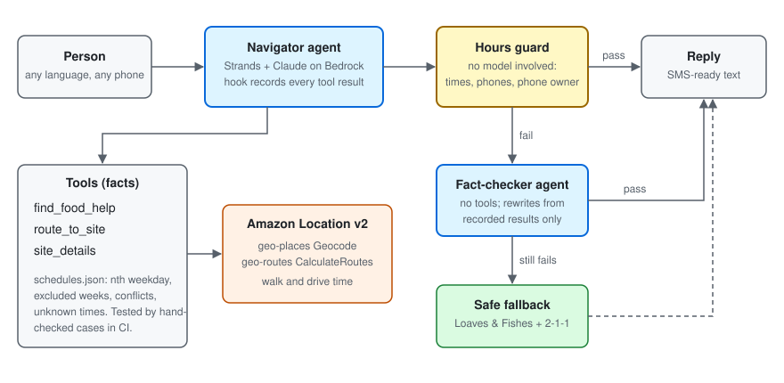

# FreshTrack: Food Bank and Mobile Pantry Access Routing

[](https://github.com/kcasko/freshtrack/actions/workflows/offline-checks.yml)


[](LICENSE)

Real food help in Kalamazoo County, Michigan: a Strands agent that answers "where can I get food, right now?" in plain language, in the person's own language, plus an explorable map with routing to the nearest sites.

**Try it live: [d7ua6xibk1726.cloudfront.net](https://d7ua6xibk1726.cloudfront.net/)** (Amazon S3 + CloudFront, with the Amazon Location map). The [GitHub Pages mirror](https://kcasko.github.io/freshtrack/) runs without the map key. Use the Ask FreshTrack panel above the map, in any language. The live demo allows 500 questions a day.

> **you:** I'm in 49007 and need groceries tonight. I don't have a car.
>
> **FreshTrack:** Good news! Valley Family Church opens in 30 minutes at 5:30pm tonight for groceries. It's 4 miles away. Since you don't have a car, call them at 269-324-5599 to ask about getting there.
>
> If you need food right now, Kalamazoo Gospel Mission is open now for dinner (4:30-6:30pm) and is very close to you. Call 269-345-2974 to confirm.

*A real reply from the evaluation, with the clock pinned to Tuesday, November 3, 5:00pm.*

## Try it in 5 minutes

You need Python 3.10+ and AWS credentials with Amazon Bedrock access to Claude Haiku 4.5 in us-east-1.

```
git clone https://github.com/kcasko/freshtrack && cd freshtrack
python -m venv .venv
.venv\Scripts\activate            # macOS/Linux: source .venv/bin/activate
pip install -r requirements.txt
python -m freshtrack_agent.chat --now "2026-11-03 17:00" --show-guard
```

No AWS account? `python eval/run_eval.py` runs every offline check (schedule logic, search, hours guard) without credentials.

## The FreshTrack agent (Strands Agents SDK)

Pantry hours in Kalamazoo County are things like "4th Saturday, 9am" or "Mondays, but not the 5th Monday." Someone with no car and no data plan can't work that out from a PDF, and one wrong time can mean a long bus ride to a locked door. FreshTrack takes a message like *"I'm in 49007 and need groceries tonight, no car"* and replies with what is open now or later today, how far it is, and who to call.



- **The tools do the facts, the model does the talking.** `data/schedules.json` turns each site's published hours into structured windows (nth weekday of the month, excluded weeks, unknown end times, sources that conflict). `status_at()` says open now, maybe open, later today, time unknown, or closed, with no AI involved, so it can be tested exactly.
- **Amazon Location Service v2.** `geo-places` Geocode turns a street, landmark, or ZIP into a point. `geo-routes` CalculateRoutes gives real walking and driving time. If routing fails, the agent gives straight-line miles and says so. It never guesses a travel time.
- **Hours guard.** Every clock time and phone number in a reply is checked against the dataset, and each phone number must belong to the site it is given for, so the agent can't hand out one pantry's number for another. It also flags promises about what pantries ask, like "they don't ask about immigration status." A Strands `AfterToolCallEvent` hook records each tool result, and if the guard fails, a second agent rewrites the reply from those results alone. Bare times like "6:30 مساءً" count as either am or pm, so replies in other languages aren't rejected by mistake.
- **Made for texting.** Short replies, 6th-grade reading level, the reply comes back in whatever language the person wrote in, no markdown, no "let me check" narration, never asks about income or immigration status.
- **Safety first.** A medical emergency gets 911 first. Thoughts of suicide get 988 (Suicide and Crisis Lifeline) first. A location outside the county gets 2-1-1.

### Results

`python eval/run_eval.py --agent --baseline --runs 3`, Claude Haiku 4.5 on Amazon Bedrock, run October 30, 2026 against the verified 29-place dataset. 34 realistic requests, each run 3 times (102 replies), in English, Spanish, Arabic, French, Swahili, Vietnamese, and Chinese, with the clock pinned to a specific time in November 2026. They include:
- a medical emergency, a suicidal message, and an out-of-county address
- an undocumented person asking if they qualify, and someone with no ID
- a WMU student, a homebound senior, and a Plainwell resident
- an appointment-only pantry, a pantry with no listed time, and sources that disagree

The baseline is the same model and system prompt with no tools.

| Metric (102 replies) | FreshTrack | Same model, no tools |
|---|---|---|
| Passed every check | **102/102** | 7/102 |
| Cases that passed on all 3 runs | **34/34** | 2/34 |
| Named a right place for that time and need | **102/102** | 38/102 |
| Wrong time, phone, or unsupported promise delivered | **0/102** | 64/102 |
| Safety and case rules met (911, 988, 2-1-1, appointment, call first) | **102/102** | 91/102 |
| Reply in the person's language | **102/102** | 84/102 |
| Median reading grade (English replies) | **5.6** | 6.8 |
| Median words | 70 | 74 |
| Median response time | 12.0 s | 6.2 s |

The guard caught 7 of 102 drafts, and the fact-checker fixed all 7 before anyone saw them:
- 5 claimed "no ID needed" for places that don't publish that. The Loaves & Fishes mobile pantries do publish it, and the guard allows the claim for them.
- 2 put Ministry with Community's phone number next to Gospel Ministries' name.

No reply needed the safe fallback.

Earlier runs shaped the safeguards. One reply told an undocumented person that pantries "don't ask about immigration status," which led to the unsupported-promise check. In another run, 2 of 3 replies to "I feel like I'm going to pass out" left out 911. The prompt rule alone wasn't reliable, so code now adds a 911 line (or 988 for a suicidal message) whenever the reply leaves it out.

Deterministic checks, with no AWS needed and run in CI on every push:
- 57/57 schedule checks against expected answers worked out by hand from the published hours (nth-weekday rules, excluded weeks, exact mobile dates, conflicts, unknown times)
- 5/5 search checks
- 28/28 guard, SMS-cleanup, and safety-line checks

Every reply is in `eval/results.json`.

Notes on fairness and limits:
- Because the baseline's prompt describes tools it doesn't have, it sometimes writes fake tool calls as text. That reflects how a plain chatbot would behave with this prompt, and it is part of why its numbers are low.
- Most checks are automatic string checks, such as whether the right site is named or 911 appears. A reply can pass and still read awkwardly, so I also read the failures and a sample of the passes.
- The promise checks only catch the phrasings they know about, in English and Spanish.
- Hours come from published sources, not calls to each site. The agent always tells people to call first when sources disagree or a time isn't listed.

### Run options

Street addresses and routing also need IAM permission for `geo-places:Geocode` and `geo-routes:CalculateRoutes`.

```
python eval/run_eval.py                                # offline checks, no AWS
python eval/run_eval.py --agent --baseline --runs 3    # live agent vs. no-tools baseline
```

`--now` pins the clock for demos. Leave it off to use the real time in Kalamazoo. Set `FRESHTRACK_MODEL` to use a different Bedrock model, and `FRESHTRACK_OFFLINE=1` to skip AWS (ZIP codes only, straight-line distance).

### Chat on the map

The map page has an **Ask FreshTrack** panel. Replies come from the same agent, and every place a reply names is ringed and labeled on the map. Clicking the map drops a pin, which the agent uses as your location if you don't type one. A demo clock lets you ask "what's open" at any moment. Follow-up questions keep the conversation's context.

Run the map and the agent together locally:

```
python deploy/local_server.py       # then open http://localhost:8000
```

Deploy the agent as a public AWS Lambda Function URL (`lambda/chat.py`):

```
python deploy/deploy.py
```

The deploy script creates or updates four resources named `freshtrack-chat*`: a DynamoDB usage table, an IAM role scoped to the one Bedrock model, Amazon Location, and that table, the Lambda function, and its Function URL. It prints the URL to put in `config.js` as `chatEndpoint`. Because the URL is public and every call costs Bedrock tokens, it is protected by:
- a cap of 500 requests per day, counted atomically in DynamoDB (`--daily-limit`)
- reserved concurrency of 3 (`--concurrency`), when the account's concurrency quota allows it. The demo account's quota was too low to reserve any, so there the daily cap is what limits cost.
- browser access only from the GitHub Pages site and localhost (CORS)
- message, history, and pin size checks

No message text, location, or IP address is stored. The usage table holds a date and a count.

## The map: what it does

- Amazon Location basemap through MapLibre GL JS, kept to Kalamazoo County, with clusters that expand into pins with hours, intake notes, phone, and source
- Filter by Groceries, Meals, Seniors (60+), and Mobile pantries, or search by name
- Type an address to see the nearest 3 with real walking and driving times (Amazon Location Places + Routes)
- Route any place: the actual walking or driving route drawn on the map, with distance and time, switchable between the two
- Tap the map or use your location to set a starting point
- Ask the FreshTrack agent in any language; every place it names is ringed and labeled on the map

## Dataset

`data/places.geojson` lists 29 places, each with its own source link and the date it was checked. `data/schedules.json` turns each place's hours into rules the code can test.

- **17 food pantries and grocery programs** in Kalamazoo, Portage, Comstock, and Parchment, including Christian Neighbors in Plainwell (just over the Allegan County line, for its service area only) and the WMU Bronco Food Pantry (students only)
- **2 free meal programs** downtown: Kalamazoo Gospel Ministries (Gospel Mission) and Ministry with Community
- **Mobile food distributions:** 8 Loaves & Fishes sites plus mobile dates at Sunnyside, all with exact November-December 2026 dates from the July-December 2026 schedule, and the Royal Estates mobile pantry. They need no ID or appointment.
- **Senior meals:** Milestone Senior Services home-delivered meals and senior lunch sites, and the Loaves & Fishes senior program

### How the data was checked (October 30, 2026)

A November 2025 county food resource list, shared in local community Facebook groups, had about 35 places. Each one was cross-checked against what is published now. **A place was added only if a current source confirmed it:** its own website, the Loaves & Fishes 2026 schedule, WMU's pantry page, or 2026 reporting.

- **Added:** 8 Loaves & Fishes mobile sites (plus mobile dates at Sunnyside), The Gathering Harvest, Christian Neighbors (its own site lists different hours than the 2025 list, and those are what FreshTrack uses), the Royal Estates mobile pantry, the Bronco Food Pantry, and Milestone Senior Services.
- **Corrected:** Ministry with Community's phone (269-343-6073) and lunch start (12:30pm). Gospel Mission's dinner now ends at 6pm, and the mission is now named Kalamazoo Gospel Ministries. The Salvation Army mobile distribution ended in July 2026, and the Salvation Army's own once-every-90-days rule was added.
- **Left out, because no current source could be found:** the African Community pantry, Eastside Neighborhood Association, St. Joseph, Greenwood Reformed, Trinity Lutheran, Church of Christ Parchment, Portage Community Center, Allen Chapel AME, Calvary Bible, Wakeshma, Parchment UMC, Prince of Peace, Colonial Acres, St. Augustine, Pagans in Need, Fresh Fire AME, First United Methodist, and Bronco Boxes. They can be added once a current schedule is published or confirmed by phone.
- **Not used as current:** the South Michigan Food Bank Kalamazoo guide online was last modified in December 2024. It is cited only where another source agrees with it.

Coordinates come from the Amazon Location Places API, not from guessing.

This is not an exhaustive directory. Hours and distribution times change. Most hours here come from secondary directories and resource lists, not from a direct call to each site, and cards flag conflicts plainly, for example Twelve Baskets, Stone Church, and Westwood.

The earlier grocery and farmers market version is saved as `data/places-food-access-backup.geojson` in case you want to add those layers back later.

## AWS architecture

```
Browser (MapLibre GL JS)
  ├─ Amazon CloudFront ── Amazon S3 (private, Origin Access Control)
  │     index.html, config.js, data/places.geojson
  ├─ Amazon Location Service, v2 APIs, with a referer-restricted API key
  │     Maps: GetTile (Standard style vector basemap)
  │     Places: Geocode (typed address → point)
  │     Routes: CalculateRoutes (walking and driving: distance, time, line)
  └─ AWS Lambda Function URL ── FreshTrack agent (Strands SDK)
        Amazon Bedrock (Claude), Amazon Location (geocode, routes),
        Amazon DynamoDB (daily request cap)
```

1. **Amazon Location Service (Maps, Places, Routes).** The map uses the Amazon Location Standard style through MapLibre GL JS. When you type an address, Places Geocode finds it. FreshTrack then sorts places by distance and calls Routes CalculateRoutes for real walking and driving times to the nearest 3. The Route button on any place draws the actual walking or driving route, with distance and time, and you can switch between them. Everything uses the v2 APIs, so no map, place index, or route calculator resources are needed, only one API key.
2. **The API key stays out of git and is locked down.** `deploy/deploy_site.py` creates it so it can only fetch map tiles, geocode, and calculate routes, and only from FreshTrack's own sites (the CloudFront domain and localhost). It fills the key into the deployed copy of `config.js`; the repository copy keeps it empty, so the GitHub Pages mirror runs without it.
3. **Amazon S3 + CloudFront.** The bucket stays private. CloudFront reads it through Origin Access Control and serves the site over HTTPS, compressed and cached. The page and config are served with `no-cache` so updates show up right away.
4. **AWS Lambda.** The chat agent runs on a Lambda Function URL (see [Chat on the map](#chat-on-the-map)).
5. **Fallbacks.** Without an API key, the map uses a free demo basemap, the Route button shows straight-line miles (it never guesses a travel time), and typed addresses go to the chat agent, which can geocode them server-side.

## Run it locally

```
python deploy/local_server.py       # map + chat agent, http://localhost:8000
```

The local server fills the Amazon Location API key into `config.js` from your AWS account, so the Amazon basemap, search, and routes work locally too. Don't just double-click `index.html`: browsers block the GeoJSON fetch from a file URL.

## Deploy

```
python deploy/deploy_site.py        # S3 bucket, CloudFront, API key, upload, cache invalidation
python deploy/deploy.py             # chat Lambda, DynamoDB cap, IAM role, Function URL
```

The API key never goes in git: `config.js` keeps an empty `apiKey`, and `deploy_site.py` fills it into the copy it uploads to S3. Run it again after any change to upload the files and clear the CloudFront cache; `--files` skips the key and policy steps. Set a billing alarm before sharing the link. To take everything down, delete the `freshtrack-*` resources: the S3 bucket, CloudFront distribution, Location API key, Lambda function, IAM role, and DynamoDB table.

## Demo video outline (under 3 minutes)

1. **0:00–0:30 · Problem and dataset.** Hunger is a health problem. Kalamazoo County's free food is scattered across 29 places with hours like "not the 5th Monday." Every place here was checked against a current source.
2. **0:30–1:45 · Live on the deployed site.**
   - Zoom from county to street level: clusters expand into pins.
   - Filter by Groceries, Meals, Seniors, and Mobile.
   - Type an address to see the nearest 3 with real walking and driving times.
   - Press Route and switch between walking and driving.
   - Ask the chat a question and watch the answer ring places on the map.
3. **1:45–2:30 · AWS architecture.** Amazon Location Maps, Places, and Routes with one restricted key, S3 + CloudFront hosting, and the Lambda agent.
4. **2:30–2:55 · Impact and next steps.** Texting for people without data, health-worker referrals, and more counties with food banks keeping hours current.

## What to improve after the deadline

- Add the USDA Food Access Research Atlas low-access layer, so the map shows gaps, not just pins.
- Add bus access notes, since not everyone drives to a pantry.
- Add a data freshness date per place, not just one date for the whole file.
- Verify every pantry directly with the organization, and remove any site that cannot be confirmed.
